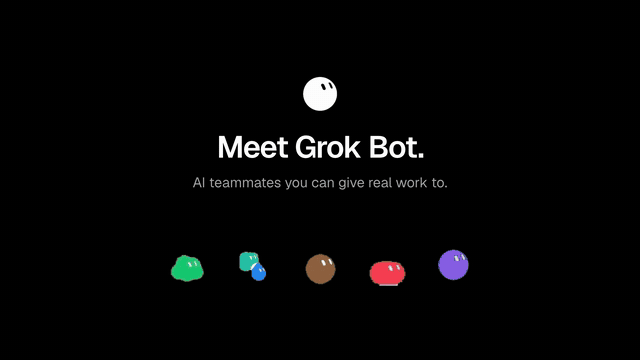

<div align="center">

# video-skills

[English](README.md) | [简体中文](README.zh-CN.md) | [日本語](README.ja.md) | [한국어](README.ko.md) | [Español](README.es.md) | [Deutsch](README.de.md) | **Français** | [Português](README.pt.md)

**Des vidéos terminées que votre agent de code peut refaire pour votre produit.**

Choisissez un film qui vous plaît, indiquez votre produit à l'agent, et obtenez le même film.

</div>

```bash
npx skills add sonnyproto/video-skills                       # toute la bibliothèque (l'agent choisit une entrée)
npx skills add sonnyproto/video-skills/launch/broll-wheel   # seulement ce film
```

Puis, dans Claude Code ou Codex :

```text
Fais un film de lancement pour https://your-product.com avec broll-wheel.
```

Rien d'autre à installer à la main : l'agent lance le `scripts/setup.sh` de l'entrée, qui vérifie Node 20+, ffmpeg et Python 3
et installe les skills HyperFrames s'ils manquent. `npx` récupère le moteur de rendu dans une version figée.

## Pourquoi ce projet

Les skills vidéo existent aujourd'hui sous deux formes. Les unes sont des paquets fermés : un style par achat, rapides, mais on ne peut
ni voir dedans ni les combiner. Les autres sont des boîtes à outils ouvertes et profondes, chacune avec son propre format, si bien que rien ne s'emboîte.

video-skills est la version plate de la première forme, faite en ouvert :

- **Une entrée = un film.** Chacune est livrée avec le `result.mp4` qu'elle a produit : vous choisissez avec les yeux.
- **Reproductible.** Chaque entrée contient un projet complet qui rend son film à l'identique, plus les ID sources des images d'archive et les prompts de tout média généré. Aucune clé d'API nécessaire.
- **Le même format partout.** Toutes les entrées ont les mêmes fichiers et la même fiche `taste.json` : vous pouvez les comparer,
  et les agents peuvent les combiner ([spec/ENTRY.md](spec/ENTRY.md)).
- **Le produit dans un seul fichier.** Pour y mettre votre produit, on modifie `film.json` et les ressources, jamais le générateur.

## Bibliothèque

<!-- CATALOG -->
| Preview | Entry | Category · method | Length | Events / 10 s |
|---|---|---|---|---|
|  | [**broll-wheel**](launch/broll-wheel/) B-roll wheel launch | launch · broll-under-type | 90 s 16:9 | 8.7 |
|  | [**feature-roster**](social/feature-roster/) Feature roster | social · rebuilt-ui-roster | 26.7 s 16:9 + 9:16 | 3.0 |
<!-- /CATALOG -->

## Anatomie d'une entrée

```
<category>/<id>/
├── SKILL.md       à charger pour faire le film
├── taste.json     la fiche : prérequis, sept couches, spécifications, mesures, ce qu'il faut, à quoi elle convient
├── references/    floor.md (règles communes), RECIPE.md (plan par plan), SWAP.md (votre produit), REFERENCE.md
├── scripts/       setup.sh (installe ce qui manque) et les scripts de mesure
├── result/        result.mp4, affiche, planche contact, aperçu, metrics.json
└── project/       un projet prêt à rendre : film.json, tools/, assets/
```

Chaque entrée est placée sur les mêmes sept couches :

| Couche | Question |
|---|---|
| floor | Qu'est-ce qui ne se négocie jamais ? (uniquement le vrai produit, exemples signalés, la marque) |
| category | Quel genre de film ? (lancement, explicatif, tutoriel, récit de données, format réseaux sociaux, jingle) |
| method | Comment l'image est-elle faite, et comment avance la colonne vertébrale ? (b-roll sous le texte, une forme jamais coupée, montage sur le beat, UI 3D...) |
| moves | Quels procédés concrets la remplissent ? (roue entre chapitres, trait de surligneur, montage d'ancres, morph de pilule...) |
| craft | Qu'est-ce qui lui donne l'air cher ? (accroche en 3 s, pic vers 35 %, impacts sur les atterrissages, -14 LUFS) |
| style | À quoi ressemble-t-il ? (étalonnage, typographie, rôles de la palette) |
| tool | Avec quoi est-il rendu ? (HyperFrames, Remotion...) |

Des couches différentes n'entrent jamais en conflit. Sur la même couche : floor > category > method > moves > craft > style.

Chaque entrée est autonome : nos fichiers communs (les règles du floor, les scripts de mesure) y sont copiés, les outils externes
(HyperFrames, ffmpeg) sont déclarés dans `requires` de `taste.json`, et le goût n'est jamais partagé. Voir [spec/ENTRY.md](spec/ENTRY.md).

## Outils

| | |
|---|---|
| `tools/floor.md` | les règles communes du floor (copiées dans `references/` de chaque entrée) |
| `tools/validate.py` | vérifie chaque entrée par rapport au format, et que ses copies des fichiers communs correspondent à `tools/` |
| `tools/catalog.py` | régénère `catalog.json` et le tableau ci-dessus |
| `tools/analyze.py <video> <out>` | coupes, plans, planche contact, LUFS, crête réelle, BPM, coupes sur le temps |
| `tools/events.py <video> <out>` | événements de changement visuel par 10 s et part d'image fixe |

## Prérequis

Node 20+, ffmpeg, Python 3. Chaque entrée indique ce qu'il lui faut en plus (une version du moteur de rendu, un modèle vidéo pour le b-roll, un modèle de musique).

## Contribuer

Les nouvelles entrées sont les bienvenues ; voir [CONTRIBUTING.md](CONTRIBUTING.md). Le niveau attendu : le projet rend son résultat à l'identique,
le produit vit dans `film.json`, le résultat est mesuré, et rien de la référence n'est redistribué.

## Remerciements

Idées et règles empruntées, avec gratitude, à [HyperFrames](https://hyperframes.heygen.com),
[huashu-motion](https://github.com/alchaincyf/huashu-motion) (rythme et notes de réalisation),
[video-shotcraft](https://github.com/Vincentwei1021/video-shotcraft) (fiches recettes et guide de substitution) et
[product-launch-motion](https://github.com/AbubakrChan/product-launch-motion) (détails de métier).

## Licence

L'exemple broll-wheel est un film spéculatif non officiel pour Muse, l'agent IA personnel de Meta. Il n'est ni affilié à Meta,
ni approuvé ou sponsorisé par Meta ; Muse et ses ressources appartiennent à Meta et ne figurent pas dans ce dépôt.

Code : MIT. Films résultants et médias générés : CC BY 4.0. Les ressources des produits d'exemple appartiennent à leurs propriétaires ; le
`taste.json` de chaque entrée indique ce qui peut être réutilisé.
